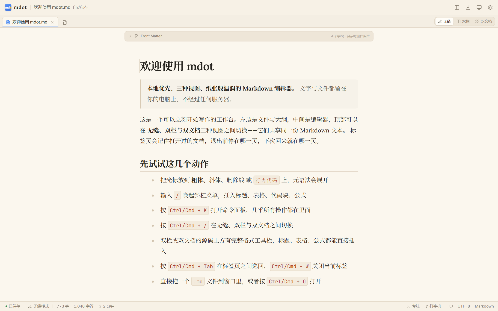
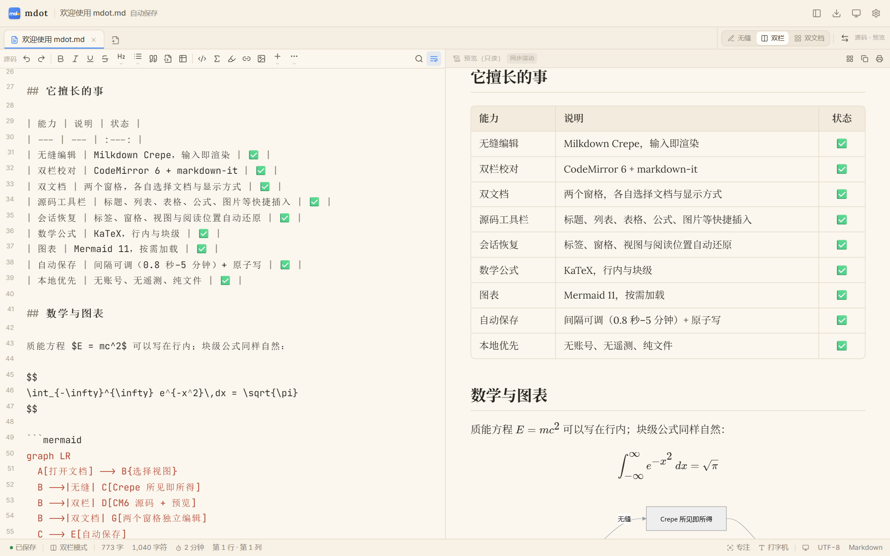
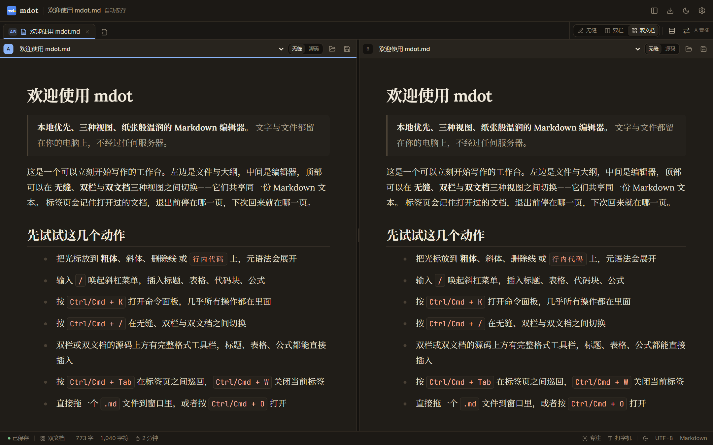
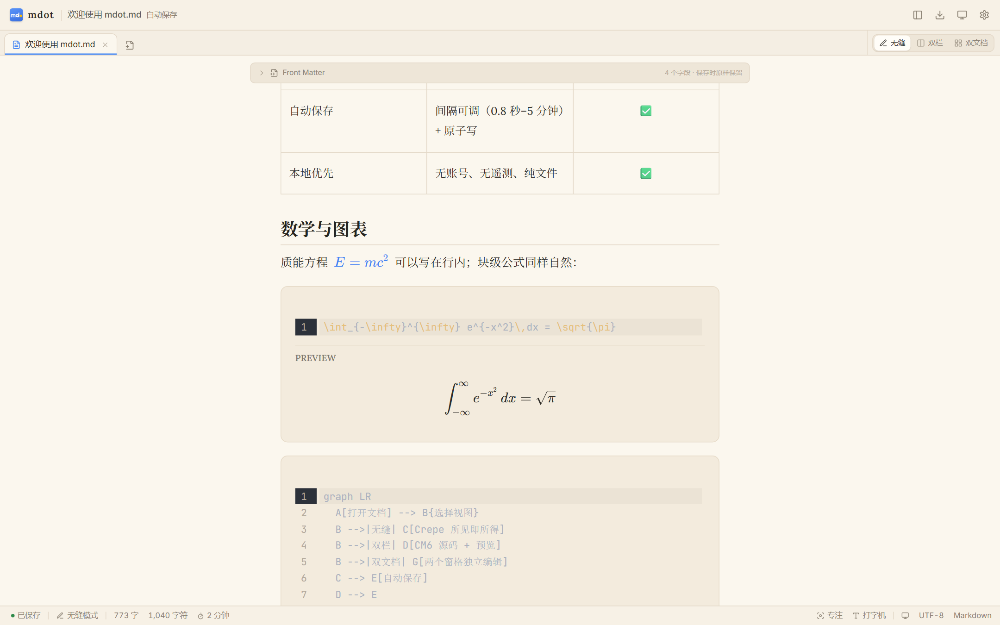

<div align="center">


# mdot

**本地优先的 Markdown 编辑器** — 无缝所见即所得、双栏源码校对、双文档并排，三种视图共享同一份文本。

A local-first Markdown editor with seamless WYSIWYG, split source/preview and dual-pane editing.
Built with Tauri 2 · React · TypeScript. No account, no telemetry, your files never leave your machine.

[](https://github.com/cdwbb/mdot/releases/latest)
[](https://github.com/cdwbb/mdot/actions/workflows/build.yml)
[](LICENSE)
[](#-下载)
[](#-下载)

</div>

---

## 📸 三种视图

**无缝模式** — Typora 式所见即所得，元语法符号隐藏，光标落点处展开。



**双栏模式** — 左 CodeMirror 6 源码、右 markdown-it 预览，源码工具栏一键插入标题、表格、公式，左右可交换。



**双文档模式** — 两个独立窗格，各自选文档、各自选视图，对照写作与翻译的刚需。



公式、图表、表格、任务清单、Front Matter 原生渲染，六套主题（暖纸 / 雪白 / 青瓷 / 墨夜 / 深空 / 跟随系统）：



---

## 📥 下载

从 [Releases 页面](https://github.com/cdwbb/mdot/releases/latest) 获取最新版本：

| 平台 | 文件 | 说明 |
|---|---|---|
| Windows 10/11 x64 | `mdot-<版本>-setup.exe` | NSIS 安装向导（中文界面），当前用户安装，无需管理员权限 |
| Windows 10/11 x64 | `mdot-<版本>-portable.exe` | 单文件便携版，复制到任意目录直接运行，不写注册表 |
| macOS 12+ (Apple Silicon) | `mdot-<版本>-aarch64.dmg` | 拖入 Applications 即可 |

校验下载完整性（每个 Release 附带 `SHA256SUMS.txt`）：

```powershell
# Windows
certutil -hashfile mdot-1.0.0-setup.exe SHA256
```

```bash
# macOS
shasum -a 256 mdot-1.0.0-aarch64.dmg
```

> **首次运行提示**：安装包未做代码签名，Windows SmartScreen 可能弹出"未知发布者"，点"仍要运行"即可；macOS 需在「系统设置 → 隐私与安全性」里允许打开。
> **依赖**：Windows 需要 [Microsoft Edge WebView2 Runtime](https://learn.microsoft.com/microsoft-edge/webview2/)，Win 10/11 通常已内置。

---

## ✨ 特性一览

| 类别 | 能力 |
|---|---|
| **编辑** | 无缝 / 双栏 / 双文档三种视图，随时切换并记忆偏好；打字机模式保持光标居中；专注模式隐藏所有面板 |
| **格式** | 标题、列表、表格、任务清单、上下标、高亮、行内代码、引用、分割线、链接、图片 |
| **扩展语法** | KaTeX 行内与块级公式、Mermaid 11 图表、代码高亮、YAML Front Matter（保存时原样保留） |
| **源码工具栏** | 双栏与双文档源码窗格上方提供完整插入工具，公式、表格、HTML 块、Front Matter 一键插入 |
| **文件** | 多标签页、工作区文件树、大纲、近期文件、拖拽打开、外部修改监听与冲突提示 |
| **图片** | 粘贴或拖拽图片自动存入文档同级 `assets/`，插入相对路径 |
| **会话** | 标签内容、当前文档、视图、窗格与阅读位置自动恢复（可在设置中关闭并清除） |
| **保存** | 失焦立即保存 + 可调自动保存间隔（0.8 秒 / 10 秒 / 30 秒 / 1 / 2 / 5 分钟），Rust 侧临时文件 + rename 原子写 |
| **导出** | 导出 HTML；PDF 走系统打印；UTF-8 写盘（读取兼容 UTF-8 / UTF-16 / GBK） |
| **外观** | 六套主题、自托管 Inter / Lora / JetBrains Mono 字体、深浅主题共用一套设计 token |
| **效率** | 命令面板（`Ctrl/Cmd + K`）覆盖几乎所有操作、完整快捷键体系、F2 重命名标签 |
| **隐私** | 纯本地读写，无账号、无遥测、无云同步；Tauri capabilities 白名单限制前端可调用的命令与权限 |

---

## ⌨️ 快捷键

`Ctrl` 在 macOS 上为 `Cmd`。

| 操作 | 快捷键 | 操作 | 快捷键 |
|---|---|---|---|
| 命令面板 | `Ctrl K` | 新建 / 打开 / 打开文件夹 | `Ctrl N` / `Ctrl O` / `Ctrl Shift O` |
| 保存 / 另存为 | `Ctrl S` / `Ctrl Shift S` | 切换三种视图 | `Ctrl /` |
| 标签页巡回 | `Ctrl Tab`（`Shift` 反向） | 关闭标签 | `Ctrl W` |
| 重命名标签 | `F2` | 导出 HTML / 打印 | `Ctrl Shift E` / `Ctrl Shift P` |
| 专注模式 | `Ctrl Shift F` | 显示/隐藏侧栏 | `Ctrl Shift B` |
| 打字机模式 | `Ctrl Shift T` | 设置 | `Ctrl ,` |
| 关闭对话框 / 退出专注 | `Esc` | 编辑器内搜索、加粗等 | `Ctrl F` / `Ctrl B` / `Ctrl I` |

---

## 🚀 开发

### 环境要求

- Node.js 20+（推荐 22+）
- Rust stable + Cargo
- Windows：Visual Studio Build Tools（MSVC + Windows SDK）
- macOS：Xcode Command Line Tools

### 常用命令

```bash
npm install
npm run tauri:dev    # 桌面端开发（热更新）
npm run dev          # 仅浏览器预览（UI 走查用，文件能力受限）
npm run check        # TypeScript 类型检查
npm run build        # 构建前端产物
npm run tauri:build  # 构建安装包
```

> **Windows 首次构建**：请在 "x64 Native Tools Command Prompt for VS 2022" 中执行，或先运行 `vcvars64.bat`，否则 Rust 可能找不到 `link.exe`。

### 项目结构

```text
src/
├─ app/          动作与命令面板（打开/保存/导出/切换视图等）
├─ components/   标题栏、标签页、侧栏、设置、命令面板、状态栏
├─ editor/       Milkdown 无缝内核、CodeMirror 源码内核、markdown-it 预览管道、mermaid/katex
├─ services/     tauriBackend / webBackend 双实现，统一 Backend 接口
├─ store/        zustand 应用状态
└─ theme.ts      六套主题的 CSS token
src-tauri/
├─ src/commands.rs   文件读写、目录树、图片落盘、外部链接、启动参数
├─ src/*.rs          notify 文件监视 → fs://changed、编码探测、原子写
└─ capabilities/     前端可调用命令与插件权限白名单
```

### 架构约定

```text
React UI + Milkdown / CodeMirror 6
        │  invoke / event
        ▼
Tauri Rust 后端
  ├─ commands.rs   读写、目录树、图片、外部链接、启动参数
  ├─ notify        文件监视 → fs://changed
  ├─ dialog/store  系统对话框、设置与最近文件
  └─ 原子写        临时文件 + rename
```

一句话规则：**文档内容的真相在前端编辑器，磁盘文件的真相在 Rust**，所有写盘动作都必须经过 Rust 侧原子写。新增前端能力时优先扩展 `Backend` 接口，保持浏览器预览模式可用。

---

## 📦 发布流程

安装产物由 GitHub Actions 从源码构建，不需要手工编译，也不要把二进制提交进仓库（`release/` 已在 `.gitignore` 中）。

```bash
# 1. 同步版本号：package.json / src-tauri/tauri.conf.json / src-tauri/Cargo.toml
#    （src/version.ts 只在浏览器预览里兜底，桌面版从二进制读取版本）
# 2. 更新 CHANGELOG.md
git commit -am "chore: release v1.0.1"
git tag v1.0.1
git push origin main --tags
```

推送 `v*` 标签会触发 [build.yml](.github/workflows/build.yml)：类型检查 → Windows（NSIS 安装版 + 便携版）与 macOS（DMG）并行构建 → 生成 `SHA256SUMS.txt` → 自动创建 Release 并上传产物。

---

## 🔒 数据与隐私

- 设置、最近文件、会话与工作区偏好：`%APPDATA%\com.mdot.editor`（macOS：`~/Library/Application Support/com.mdot.editor`）
- 文档始终保存在你打开的位置，mdot 不上传、不同步任何文件
- 无遥测、无崩溃上报、无后台网络请求
- 设置中可关闭"记住打开的文档"，关闭时会一并清除已保存的会话

---

## ⚠️ 已知限制

诚实清单，欢迎提 Issue 或 PR 改进：

- **未做代码签名**：Windows SmartScreen 与 macOS _gatekeeper_ 会拦一次；自动更新尚未落地。
- **无 docx 导出、无 Vim 键位**。
- **Milkdown 往返保真**：无缝模式保存会重新序列化 Markdown，表格对齐与少数转义可能被规范化；尚无往返保真测试。
- **编码**：读取兼容 UTF-8 / UTF-16 / GBK，但保存统一写回 UTF-8，不保留原编码。
- **会话恢复**：保存的是滚动比例，含大量异步图表或图片的长文档首次恢复可能有轻微偏移。
- **CSP 未启用**（`csp: null`），需在确认 Milkdown/CodeMirror 内联样式依赖后收紧；`assetProtocol.scope` 目前为 `**`，按需收窄。
- **浏览器预览模式**（`npm run dev`）用于 UI 走查，文件能力依赖 File System Access API，完整能力请用桌面版。
- **启动与内存基线**（Windows 10 实测）：空窗口约 1.0s 可见、带文件约 1.6s 可编辑；主进程 + WebView2 私有内存约 240–260MB。设计目标 400ms / 150MB 尚未达成。

---

## 🤝 贡献

请先阅读 [CONTRIBUTING.md](CONTRIBUTING.md)。简要约定：

- 分支 `main`，提交信息用 Conventional Commits（`feat:` / `fix:` / `docs:` …）
- 提交前跑 `npm run check`，确保类型检查通过
- 改动编辑器内核时，注意无缝/双栏/双文档三条路径都要验证
- 大功能请先开 Issue 讨论，避免返工

Found a bug or want a feature? [Open an issue](https://github.com/cdwbb/mdot/issues).

---

## 🙏 致谢

mdot 站在这些开源项目的肩膀上：[Tauri](https://tauri.app/)、[Milkdown](https://milkdown.dev/)、[CodeMirror](https://codemirror.net/)、[markdown-it](https://github.com/markdown-it/markdown-it)、[KaTeX](https://katex.org/)、[Mermaid](https://mermaid.js.org/)、[highlight.js](https://highlightjs.org/)、[DOMPurify](https://github.com/cure53/DOMPurify)、[zustand](https://zustand.docs.pmnd.rs/)、[React](https://react.dev/)、[Vite](https://vite.dev/)，以及 [Inter](https://rsms.me/inter/)、[Lora](https://fonts.google.com/specimen/Lora)、[JetBrains Mono](https://www.jetbrains.com/lp/mono/) 三款字体。

设计目标参照 Typora 的无缝编辑体验 — 它更好的一点是收费且闭源，mdot 想做一个开源、更轻、还能双栏校对的版本。

## 📄 License

[MIT](LICENSE) © 2026 mdot contributors

版本历史见 [CHANGELOG.md](CHANGELOG.md)，技术选型与取舍见 [docs/technical-plan.md](docs/technical-plan.md)。
